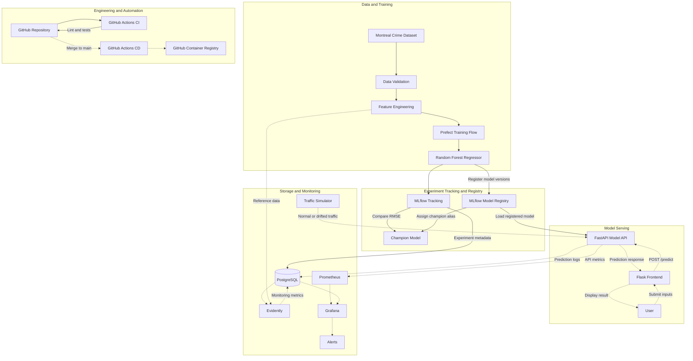

# Montréal Crime Count Prediction

INSY 684 – Final Project | Desautels Faculty of Management 

## 1. Project Overview

This project develops an end-to-end machine learning
operations (MLOps) system to predict the daily number
of reported crimes in Montréal using historical
crime data.

The objective is to build a reproducible and
containerized machine learning system that covers
data validation, feature engineering, automated
model training, experiment tracking, model serving
and continuous monitoring.

The project focuses on the operational lifecycle of
a machine learning model, including its deployment,
accessibility, reliability and performance over time.

## 2. Dataset and Feature Engineering

The dataset contains historical crime incidents
reported in Montréal, with one observation per
reported incident.

Expected dataset location:

`data/crimes_montreal_en.csv`

The preprocessing pipeline validates the raw data,
aggregates incidents by calendar day and assigns
a count of zero to days with no reported incidents.

The target variable is `crime_count`, representing
the total number of reported crimes per day.

The model uses six input features:

| Feature | Description |
|---|---|
| day_of_week | Day of the week, from Monday (0) to Sunday (6) |
| month | Month of the year |
| is_weekend | Binary indicator of whether the day is a weekend |
| lag_1 | Crime count from the previous day |
| lag_7 | Crime count from seven days earlier |
| rolling_mean_7 | Average daily crime count over the previous seven days |

Historical features are calculated using only
observations preceding the prediction date to
prevent target leakage.

## 3. System Architecture

The following diagram illustrates how the training,
serving and monitoring components interact.

Solid arrows represent connections established in
the reviewed training and serving code.
Dashed arrows represent frontend and monitoring
connections that require implementation or
integration verification.



## 4. Model Training and Experiment Tracking

The model is a Random Forest Regressor trained
through an orchestrated Prefect pipeline.

The training pipeline performs the following steps:

1. Load and validate the raw crime dataset.
2. Aggregate incidents and generate daily features.
3. Train multiple Random Forest configurations.
4. Record model parameters and evaluation metrics
   in MLflow.
5. Register trained model versions.
6. Assign the champion alias to the best model.

The hyperparameter grid contains six configurations:

| Hyperparameter | Values |
|---|---|
| n_estimators | 100, 300 |
| max_depth | 5, 10, None |
| random_state | 42 |

The data is split chronologically, with the oldest
80% used for training and the most recent 20%
used for evaluation.

Model performance is evaluated using:

- Root Mean Squared Error (RMSE)
- Mean Absolute Error (MAE)
- Historical mean baseline
- Seven-day lag baseline

The model with the lowest recorded RMSE is selected
as the champion.

### MLflow Configuration

- Experiment: `crime-count`
- Registered model: `insy684-model`
- Best model alias: `champion`

## 5. Technology Stack

| Tool | Role in the Project |
|---|---|
| Pandas | Data loading, validation, aggregation and feature engineering |
| Scikit-learn | Random Forest training and model evaluation |
| Prefect | Orchestration of the automated training pipeline |
| MLflow | Experiment tracking, model registration and version management |
| FastAPI | REST API for serving predictions from registered models |
| Flask | User-facing application that communicates with the model API |
| Docker | Containerization of application components |
| Docker Compose | Coordination and networking of application services |
| PostgreSQL | MLflow metadata storage and intended monitoring data storage |
| Traffic Simulator | Generation of normal and drifted prediction requests |
| Evidently | Data drift and model performance evaluation |
| Prometheus | Collection of operational API metrics |
| Grafana | Visualization of system performance, drift and alerts |
| Pytest | Automated unit and integration testing |
| Ruff | Python linting and code quality checks |
| GitHub Actions | Automation of testing, linting and deployment workflows |
| GitHub Container Registry | Intended storage of published Docker images |
| Mermaid | Architecture documentation using diagram-as-code |

## 6. Local Setup

### Prerequisites

- Git
- Python
- Docker Desktop
- Docker Compose
- Access to the crime dataset

### Clone the Repository

```bash
git clone https://github.com/astridphilippet/insy684-final-project.git
cd insy684-final-project
```

### Configure Environment Variables

Create a local environment file using `.env.example`.

Windows PowerShell:

```powershell
Copy-Item .env.example .env
```

macOS or Linux:

```bash
cp .env.example .env
```

Configure the following variables in `.env`:

- POSTGRES_USER
- POSTGRES_PASSWORD
- POSTGRES_DB
- MODEL_NAME=insy684-model

Use local credentials and do not commit the `.env`
file to GitHub.

### Prepare the Dataset

Place the crime dataset in the following directory:

```text
data/crimes_montreal_en.csv
```

### Start the Services

```bash
docker compose up -d --build
```

Check the status of the containers:

```bash
docker compose ps
```

View service logs:

```bash
docker compose logs -f
```

The current Docker Compose configuration starts
PostgreSQL, MLflow, the model API, Prometheus,
Grafana and a frontend service placeholder.

### Run the Training Pipeline

The training flow runs from the repository root
in a Python environment containing the required
training dependencies.

Install the training dependencies using the
project's dependency specifications where available.
The core libraries include Prefect, MLflow, Pandas,
Scikit-learn and Skops.

For local training on Windows PowerShell:

```powershell
$env:MLFLOW_TRACKING_URI = "http://localhost:5000"
python -m flows.training_flow --data data/crimes_montreal_en.csv
```

For macOS or Linux:

```bash
export MLFLOW_TRACKING_URI=http://localhost:5000
python -m flows.training_flow --data data/crimes_montreal_en.csv
```

The training flow registers trained models in
MLflow and identifies the champion model.

The API currently defaults to loading the latest
registered version. Champion alias serving requires
additional configuration or an update to the
model-loading URI.

## 7. Application Services

| Service | Local Address |
|---|---|
| PostgreSQL | localhost:5432 |
| MLflow | http://localhost:5000 |
| FastAPI | http://localhost:8000 |
| FastAPI Documentation | http://localhost:8000/docs |
| Flask Frontend (planned) | http://localhost:8080 |
| Prometheus | http://localhost:9090 |
| Grafana | http://localhost:3000 |

## 8. Model API

The FastAPI service retrieves a registered model
from MLflow and exposes prediction functionality
through a REST API.

The model is loaded when the first prediction
request is received and cached for subsequent
requests.

### API Endpoints

| Method | Endpoint | Purpose |
|---|---|---|
| GET | /health | Check API status and whether the model is loaded |
| POST | /predict | Generate a daily crime count prediction |

### Example Prediction Request

```json
{
  "features": {
    "day_of_week": 4,
    "month": 11,
    "is_weekend": 0,
    "lag_1": 42.0,
    "lag_7": 38.0,
    "rolling_mean_7": 40.5
  }
}
```

### Illustrative Response

```json
{
  "prediction": 41.2
}
```

The response above is illustrative and does not
represent an actual model evaluation.

The API returns an error when the registered model
is unavailable or the supplied features are invalid.

## 9. Flask Frontend

The frontend is designed to provide an accessible
interface for obtaining daily crime count predictions
without interacting directly with the model API.

Users will provide:

- Prediction date
- Crime count from the previous day
- Crime count from seven days earlier
- Average crime count over the previous seven days

The Flask application derives the calendar features
from the selected date and sends all six required
features to FastAPI in JSON format.

The prediction returned by FastAPI is displayed
through the web interface.

The frontend operates independently from the model
API and is intended to run in a separate Docker
container on port 8080.

Frontend development is currently in progress.

## 10. Monitoring and Drift Detection

The monitoring architecture is designed to assess
both application reliability and model performance.

### Operational Monitoring

Prometheus is intended to collect:

- API request counts
- Request latency
- Error rates

Grafana visualizes these operational metrics and
supports configurable alerts.

### Model Monitoring

Evidently is intended to compare incoming prediction
data with reference data to identify changes in
feature distributions.

Model performance metrics can also be calculated
when actual crime counts become available.

PostgreSQL is intended to store prediction logs
and monitoring results for visualization in Grafana.

### Traffic Simulation

The traffic simulator will submit unseen observations
to the application under normal and drifted conditions.

### Normal Traffic Dashboard

Screenshot and observations to be added following
the normal traffic simulation.

### Drifted Traffic Dashboard

Screenshot, drift metrics and evidence of an alert
or retraining trigger to be added following the
drift simulation.

The monitoring connections and alert behaviour
must be verified once all components are integrated.

## 11. Testing and Continuous Integration

The project uses Pytest and Ruff to support automated
testing and Python code quality.

The testing strategy includes:

- Data validation
- Feature engineering correctness
- Model performance against a baseline
- Prediction validity
- Drift detection
- API integration

GitHub Actions runs automated quality checks to
support the pull request workflow.

The continuous deployment objective is to build
Docker images following merges into the main branch
and publish them to GitHub Container Registry.

## 12. Teardown

Stop and remove the application containers:

```bash
docker compose down
```

Restart the application:

```bash
docker compose up -d --build
```

The MLflow artifact volume is retained by a standard
teardown. PostgreSQL persistence should be verified
before removing containers, since the reviewed
configuration does not define a dedicated database
volume.

## 13. Collaboration Workflow

The project follows a feature-branch development
workflow:

1. Create a branch for each contribution.
2. Make descriptive commits.
3. Open a pull request.
4. Obtain a review from another team member.
5. Address review comments and verify automated checks.
6. Merge using a merge commit or rebase.

Credentials and sensitive environment variables
must never be committed to the repository.

## 14. Project Status

This documentation reflects the current development
stage of the project and will be updated as the
frontend, monitoring and deployment components are
fully integrated and tested.
